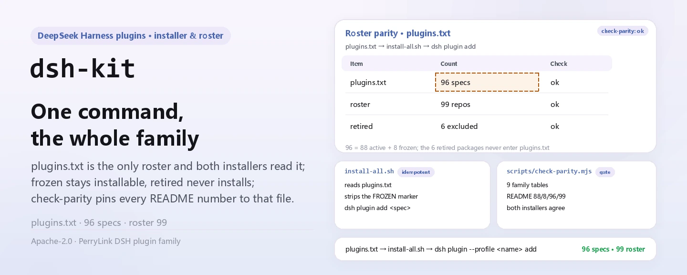
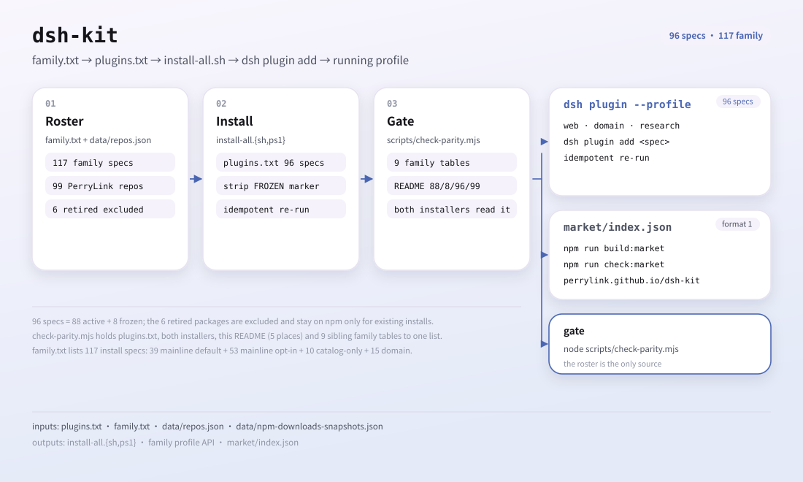
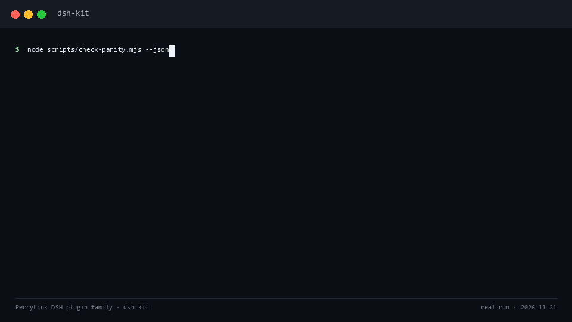

<div align="center">

<picture>
  <source media="(prefers-color-scheme: dark)" srcset="docs/assets/dsh-kit-hero-en-dark.webp">
  
</picture>

# dsh-kit

[English](README.md) · [简体中文](README-zh.md) · [Español](README-es.md) · [Português](README-pt.md) · [हिन्दी](README-hi.md)

</div>

[](https://gitee.com/perrylink/dsh-kit)
[](https://dshfind.com/plugins/PerryLink/dsh-kit?ref=badge)

[](https://github.com/PerryLink/dsh-kit/actions)
[](https://www.npmjs.com/package/dsh-kit)

**Pack de inicio de un solo comando para los plugins de PerryLink DeepSeek Harness que se mantienen activos, más los congelados que siguen siendo instalables.**

[dsh-kit](https://github.com/PerryLink/dsh-kit) es el instalador y el roster de la línea principal de [la familia completa de plugins DSH de PerryLink](https://github.com/PerryLink/PerryLink/blob/main/FAMILY.md): estándares y comprobaciones de tres niveles, guías, la cadena de herramientas de desarrollo, plugins de runtime, la suite de cumplimiento de 53 comprobadores, operaciones de dominio, catálogos y la línea de decisión Phocinae, que va por separado. Cada plugin se entrega con un manifiesto `dsh.bundle` completo, documentación en cinco idiomas, CI y publicación en npm.

<picture>
  <source media="(prefers-color-scheme: dark)" srcset="docs/assets/dsh-kit-flow-v5-dark.svg">
  
</picture>

*Estructura: family.txt + data/repos.json → plugins.txt → install-all → dsh plugin add → compuerta. Las etiquetas del diagrama son nombres reales de archivo, de script y de comando, por eso una sola imagen sirve para los cinco idiomas.*


## Inicio rápido



*Animación: node scripts/check-parity.mjs --json re-ejecutado el 2026-11-21 — los recuentos del roster que la compuerta deriva de plugins.txt (stdout real; las líneas de resumen para humanos se imprimen antes de este JSON).*

Elige un perfil (por ejemplo `web`) e instala todo:

```sh
# Linux / macOS
./install-all.sh web

# Windows PowerShell
.\install-all.ps1 -Profile web
```

O instala plugins individuales:

```sh
dsh plugin --profile web add dsh-checkpoint-rewind   # /rewind equivalent
dsh plugin --profile web add dsh-permission-rules    # allow/deny/ask rules
dsh plugin --profile web add dsh-output-styles       # outputStyles equivalent
```

## Qué incluye (destacados seleccionados — los instaladores cubren 43 specs de npm, más 53 opcionales (96 en total))

Dos de los destacados siguientes están **retirados** y uno está **congelado**. Todos siguen listados y siguen siendo
instalables porque ya hay gente que los usa: 🧊 **FROZEN** significa que no hay nuevas funciones y solo se corrige una rotura real; 🚫 **RETIRED**
significa que el host ya hace esto de forma nativa y el paquete está marcado como obsoleto en npm — los paquetes retirados **no** están en
`plugins.txt`, así que una instalación nueva nunca se los trae.

### El trío de paridad con Claude Code

| Plugin | Resumen de una línea |
|---|---|
| [dsh-checkpoint-rewind](https://github.com/PerryLink/dsh-checkpoint-rewind) | Snapshots con Git primero antes de cada mutación, bifurcaciones de sesión y restauración `/rewind` de un solo paso |
| [dsh-permission-rules](https://github.com/PerryLink/dsh-permission-rules) | Reglas de permisos allow/deny/ask declarativas con auditoría, simulación (dry-run) y recarga en caliente |
| [dsh-output-styles](https://github.com/PerryLink/dsh-output-styles) | Estilos de salida del modelo conmutables en runtime con persistencia por sesión |

### Memoria, agentes y flujo de trabajo

| Plugin | Resumen de una línea | Estado |
|---|---|---|
| [dsh-memento](https://github.com/PerryLink/dsh-memento) | Memoria entre sesiones con aprobación: `ctx.memory` + SQLite + herramienta `memory` | |
| [dsh-background-agents](https://github.com/PerryLink/dsh-background-agents) | Agentes hijos en segundo plano duraderos: progreso en la barra lateral, mensajería, interrupción | 🚫 **RETIRED** — el host ya incluye subagentes continuables nativos |
| [dsh-doublecheck](https://github.com/PerryLink/dsh-doublecheck) | Guardián de disciplina de ingeniería: interrogatorio de requisitos, compuertas de test y revisión adversaria | |
| [dsh-auto-review](https://github.com/PerryLink/dsh-auto-review) | Auto-revisión con un segundo modelo en la cadena de aprobación, con fallo cerrado (fail-closed) | |

### Herramientas de desarrollo y seguridad

| Plugin | Resumen de una línea |
|---|---|
| [dsh-mcp-panel](https://github.com/PerryLink/dsh-mcp-panel) | Panel de runtime MCP de solo lectura: `/mcp` + pestaña de Ajustes |
| [dsh-lsp-actions](https://github.com/PerryLink/dsh-lsp-actions) | Diagnósticos LSP, formateo, autocompletado, acciones de código y renombrado |
| [dsh-github-bot](https://github.com/PerryLink/dsh-github-bot) | Integración con PR e issues de GitHub; toda escritura pasa por aprobación humana |
| [dsh-security-pack](https://github.com/PerryLink/dsh-security-pack) | Pack de skills de auditoría de seguridad: escaneo de secretos, revisión de dependencias y de cadena de suministro |

### UX y migración

| Plugin | Resumen de una línea | Estado |
|---|---|---|
| [dsh-session-pin](https://github.com/PerryLink/dsh-session-pin) | Fija sesiones en la barra lateral de la Web con orden duradero | 🚫 **RETIRED** — el host ya incluye la fijación de sesiones de forma nativa |
| [dsh-composer-history](https://github.com/PerryLink/dsh-composer-history) | Historial de entrada estilo terminal para el compositor web: flechas, Ctrl+R | |
| [dsh-primer](https://github.com/PerryLink/dsh-primer) | Base de conocimiento de desarrollo de plugins como skill de agente bajo demanda | |
| [dsh-claude-move](https://github.com/PerryLink/dsh-claude-move) | Migra sesiones, memoria, skills y CLAUDE.md de Claude Code a DSH | 🧊 FROZEN — ver el README del repo |

## Notas

- El conjunto instalado es [`plugins.txt`](plugins.txt) — un spec de npm por línea y el único lugar donde queda escrito el roster. Ambos instaladores lo leen, y `node scripts/check-parity.mjs` los obliga a ellos y a cada recuento de esta página a cuadrar con él.
- **Los paquetes retirados no están en `plugins.txt`**, así que una instalación nueva nunca los trae, y la compuerta falla si alguien vuelve a añadir uno. Los cinco nombres retirados, y el motivo, están en el comentario de cabecera del propio archivo.
- **Los paquetes congelados sí están en `plugins.txt`** y se instalan; un comentario final `# 🧊 FROZEN` en su línea los marca, y ambos instaladores quitan ese comentario antes de llamar a `dsh plugin add`.
- Los scripts de instalación son **idempotentes**: se pueden volver a ejecutar sin riesgo.
- `dsh-security-pack` se instala desde npm.
- Las versiones siguen las últimas publicaciones de npm; fija una versión concreta por plugin si necesitas reproducibilidad.
- Los nombres obsoletos no se instalan: `dsh-background-agents`, `dsh-session-pin` y `dsh-team-rooms` (el host ya implementa los tres de forma nativa), y `dsh-plugin-upgrade-015` con su nombre anterior `dsh-plugin-upgrade-rc1` (sustituidos por `dsh-codemod`, que reúne todos los corredores en un solo paquete). Siguen en npm para quien ya los tenga instalados.
- Licencia: Apache-2.0 (la misma de la familia de plugins).

## Índice personal de plugins

[`market/index.json`](market/index.json) es un índice en [formato 1 de plugin-market de DSH](https://github.com/deepseek-ai/deepseek-harness/blob/master/docs/user/guide/plugin-market.md) generado a partir de este roster. Solo lista paquetes de PerryLink y se publica en `https://perrylink.github.io/dsh-kit/index.json`; añádelo en **Plugins → Discover → Add index source** de DSH. Es independiente de cualquier mercado oficial o comunitario y no sustituye a los instaladores.

```sh
npm ci
npm run build:market   # regenerate from plugins.txt + family.txt (reads npm)
npm run check:market   # offline format/coverage checks
npm run test:market    # offline generator fixtures
```

Ver [`market/README.md`](market/README.md) para el soporte de clientes (incluidos los límites de dsh-Go/dsh-TUI), la lista de bloqueo y la capa de visualización.

## Comentarios

Las incidencias y peticiones de funciones se abren en el repositorio del plugin correspondiente, o se debate sobre toda la familia en las [Discussions oficiales de DeepSeek Harness](https://github.com/deepseek-ai/deepseek-harness/discussions) (categoría «Show Your Plugins!»).


## Familia de plugins PerryLink DSH

Este proyecto forma parte de la familia de plugins de DeepSeek Harness de [PerryLink](https://github.com/PerryLink). La familia tiene tres capas — estándares y guías, cadena de herramientas de desarrollo, plugins de runtime y de dominio — más la línea de decisión Phocinae; el índice completo grupo por grupo está en [FAMILY.md](https://github.com/PerryLink/PerryLink/blob/main/FAMILY.md). El roster de instalación se deja plegado aquí abajo para que todos los README mantengan una primera pantalla corta; despliégalo para ver cada fila y su estado.

<details>
<summary>Expandir todos los plugins</summary>

| Plugin | Estado |
|---|---|
| **[dsh-aqua-input-check](https://github.com/PerryLink/dsh-aqua-input-check)** |  |
| **[dsh-archive-check](https://github.com/PerryLink/dsh-archive-check)** |  |
| **[dsh-auto-review](https://github.com/PerryLink/dsh-auto-review)** |  |
| **[dsh-autotier](https://github.com/PerryLink/dsh-autotier)** | 🧊 FROZEN — ver el README del repo |
| **[dsh-bid-ca-precheck](https://github.com/PerryLink/dsh-bid-ca-precheck)** |  |
| **[dsh-bid-qual-check](https://github.com/PerryLink/dsh-bid-qual-check)** |  |
| **[dsh-cert-mcp](https://github.com/PerryLink/dsh-cert-mcp)** | 🧊 FROZEN — ver el README del repo |
| **[dsh-checkpoint-rewind](https://github.com/PerryLink/dsh-checkpoint-rewind)** |  |
| **[dsh-click](https://github.com/PerryLink/dsh-click)** |  |
| **[dsh-community-bench](https://github.com/PerryLink/dsh-community-bench)** | 🧊 FROZEN — ver el README del repo |
| **[dsh-composer-history](https://github.com/PerryLink/dsh-composer-history)** |  |
| **[dsh-contract-stance](https://github.com/PerryLink/dsh-contract-stance)** |  |
| **[dsh-customs-doc-check](https://github.com/PerryLink/dsh-customs-doc-check)** |  |
| **[dsh-data-quality](https://github.com/PerryLink/dsh-data-quality)** |  |
| **[dsh-demurrage-ledger](https://github.com/PerryLink/dsh-demurrage-ledger)** |  |
| **[dsh-doublecheck](https://github.com/PerryLink/dsh-doublecheck)** |  |
| **[dsh-drill-script-check](https://github.com/PerryLink/dsh-drill-script-check)** |  |
| **[dsh-eia-guide-check](https://github.com/PerryLink/dsh-eia-guide-check)** |  |
| **[dsh-emergency-plan](https://github.com/PerryLink/dsh-emergency-plan)** |  |
| **[dsh-essay-rubric-check](https://github.com/PerryLink/dsh-essay-rubric-check)** |  |
| **[dsh-evidence-check](https://github.com/PerryLink/dsh-evidence-check)** |  |
| **[dsh-export-ctl-check](https://github.com/PerryLink/dsh-export-ctl-check)** |  |
| **[dsh-fast](https://github.com/PerryLink/dsh-fast)** |  |
| **[dsh-fmea-table-check](https://github.com/PerryLink/dsh-fmea-table-check)** |  |
| **[dsh-forecast-penalty](https://github.com/PerryLink/dsh-forecast-penalty)** |  |
| **[dsh-fund-research](https://github.com/PerryLink/dsh-fund-research)** |  |
| **[dsh-github-bot](https://github.com/PerryLink/dsh-github-bot)** |  |
| **[dsh-gongwen-flow-check](https://github.com/PerryLink/dsh-gongwen-flow-check)** |  |
| **[dsh-gongwen-word-check](https://github.com/PerryLink/dsh-gongwen-word-check)** |  |
| **[dsh-guard-plan-qc](https://github.com/PerryLink/dsh-guard-plan-qc)** |  |
| **[dsh-hazchem-check](https://github.com/PerryLink/dsh-hazchem-check)** |  |
| **[dsh-hazplan-check](https://github.com/PerryLink/dsh-hazplan-check)** |  |
| **[dsh-hidden-risk-map](https://github.com/PerryLink/dsh-hidden-risk-map)** |  |
| **[dsh-hs-classify](https://github.com/PerryLink/dsh-hs-classify)** |  |
| **[dsh-icd-rule-check](https://github.com/PerryLink/dsh-icd-rule-check)** |  |
| **[dsh-industry-research](https://github.com/PerryLink/dsh-industry-research)** |  |
| **[dsh-lawcite-adapter](https://github.com/PerryLink/dsh-lawcite-adapter)** |  |
| **[dsh-laya](https://github.com/PerryLink/dsh-laya)** |  |
| **[dsh-lc-doc-check](https://github.com/PerryLink/dsh-lc-doc-check)** |  |
| **[dsh-learning-gap-check](https://github.com/PerryLink/dsh-learning-gap-check)** |  |
| **[dsh-library](https://github.com/PerryLink/dsh-library)** |  |
| **[dsh-local-ai](https://github.com/PerryLink/dsh-local-ai)** |  |
| **[dsh-lsp-actions](https://github.com/PerryLink/dsh-lsp-actions)** |  |
| **[dsh-mask](https://github.com/PerryLink/dsh-mask)** |  |
| **[dsh-mcp-panel](https://github.com/PerryLink/dsh-mcp-panel)** |  |
| **[dsh-medrec-qc](https://github.com/PerryLink/dsh-medrec-qc)** |  |
| **[dsh-memento](https://github.com/PerryLink/dsh-memento)** |  |
| **[dsh-nsfc-form-check](https://github.com/PerryLink/dsh-nsfc-form-check)** |  |
| **[dsh-nurse-record-check](https://github.com/PerryLink/dsh-nurse-record-check)** |  |
| **[dsh-observe](https://github.com/PerryLink/dsh-observe)** |  |
| **[dsh-origin-rvc-check](https://github.com/PerryLink/dsh-origin-rvc-check)** |  |
| **[dsh-ota-review-check](https://github.com/PerryLink/dsh-ota-review-check)** |  |
| **[dsh-output-styles](https://github.com/PerryLink/dsh-output-styles)** |  |
| **[dsh-paper-doc-adapter](https://github.com/PerryLink/dsh-paper-doc-adapter)** |  |
| **[dsh-permission-rules](https://github.com/PerryLink/dsh-permission-rules)** |  |
| **[dsh-permit-report-check](https://github.com/PerryLink/dsh-permit-report-check)** |  |
| **[dsh-pipeline-check](https://github.com/PerryLink/dsh-pipeline-check)** |  |
| **[dsh-pleading-draft](https://github.com/PerryLink/dsh-pleading-draft)** |  |
| **[dsh-clinic](https://github.com/PerryLink/dsh-clinic)** |  |
| **[dsh-primer](https://github.com/PerryLink/dsh-primer)** |  |
| **[dsh-scaffold](https://github.com/PerryLink/dsh-scaffold)** |  |
| **[dsh-codemod](https://github.com/PerryLink/dsh-codemod)** |  |
| **[dsh-policy-brief-draft](https://github.com/PerryLink/dsh-policy-brief-draft)** |  |
| **[dsh-power-loss-split](https://github.com/PerryLink/dsh-power-loss-split)** |  |
| **[dsh-power-ticket-check](https://github.com/PerryLink/dsh-power-ticket-check)** |  |
| **[dsh-ppap-check](https://github.com/PerryLink/dsh-ppap-check)** |  |
| **[dsh-protest-deadline](https://github.com/PerryLink/dsh-protest-deadline)** |  |
| **[dsh-railway-window](https://github.com/PerryLink/dsh-railway-window)** |  |
| **[dsh-repair-order-qc](https://github.com/PerryLink/dsh-repair-order-qc)** |  |
| **[dsh-research-report](https://github.com/PerryLink/dsh-research-report)** |  |
| **[dsh-review-reply-check](https://github.com/PerryLink/dsh-review-reply-check)** |  |
| **[dsh-rulefile-check](https://github.com/PerryLink/dsh-rulefile-check)** |  |
| **[dsh-safety-brief-check](https://github.com/PerryLink/dsh-safety-brief-check)** |  |
| **[dsh-score](https://github.com/PerryLink/dsh-score)** |  |
| **[dsh-session-sync](https://github.com/PerryLink/dsh-session-sync)** |  |
| **[dsh-site-log-check](https://github.com/PerryLink/dsh-site-log-check)** |  |
| **[dsh-security-pack](https://github.com/PerryLink/dsh-security-pack)** |  |
| **[dsh-soe-decision-check](https://github.com/PerryLink/dsh-soe-decision-check)** |  |
| **[dsh-soilwater-check](https://github.com/PerryLink/dsh-soilwater-check)** |  |
| **[dsh-sop-sync-check](https://github.com/PerryLink/dsh-sop-sync-check)** |  |
| **[dsh-spc-gbt-adapter](https://github.com/PerryLink/dsh-spc-gbt-adapter)** |  |
| **[dsh-talk](https://github.com/PerryLink/dsh-talk)** |  |
| **[dsh-tender-extract](https://github.com/PerryLink/dsh-tender-extract)** |  |
| **[dsh-tender-matrix](https://github.com/PerryLink/dsh-tender-matrix)** |  |
| **[dsh-test-drive](https://github.com/PerryLink/dsh-test-drive)** |  |
| **[dsh-dida](https://github.com/PerryLink/dsh-dida)** |  |
| **[dsh-param-repair](https://github.com/PerryLink/dsh-param-repair)** |  |
| **[dsh-warranty-calc](https://github.com/PerryLink/dsh-warranty-calc)** |  |
| **[dsh-catalog](https://github.com/PerryLink/dsh-catalog)** |  |
| **[dsh-plugin-certification](https://github.com/PerryLink/dsh-plugin-certification)** |  |
| **[dsh-plugin-portal](https://github.com/PerryLink/dsh-plugin-portal)** |  |
| **[dsh-budget](https://github.com/PerryLink/dsh-budget)** | 🧊 FROZEN — ver el README del repo |
| **[dsh-claude-move](https://github.com/PerryLink/dsh-claude-move)** | 🧊 FROZEN — ver el README del repo |
| **[dsh-defend](https://github.com/PerryLink/dsh-defend)** | 🧊 FROZEN — ver el README del repo |
| **[dsh-draw](https://github.com/PerryLink/dsh-draw)** | 🧊 FROZEN — ver el README del repo |
| **[dsh-reach](https://github.com/PerryLink/dsh-reach)** | 🧊 FROZEN — ver el README del repo |
| **[dsh-background-agents](https://github.com/PerryLink/dsh-background-agents)** | 🚫 RETIRED — ver el README del repo |
| **[dsh-session-pin](https://github.com/PerryLink/dsh-session-pin)** | 🚫 RETIRED — ver el README del repo |
| **[dsh-team-rooms](https://github.com/PerryLink/dsh-team-rooms)** | 🚫 RETIRED — ver el README del repo |

</details>

## Fuera del roster de instalación

Dos superficies son solo de catálogo, se instalan por nombre y están deliberadamente ausentes de `plugins.txt` / `family.txt`
(así que `install-all` no las instala):

- **`dsh-translate` 0.3.2** — traducción de página completa en la GUI web sobre tu propia ruta de modelo; el código, las rutas, los comandos,
  los identificadores y los nombres de producto se mantienen tal cual. `dsh plugin --profile <name> add dsh-translate`.
- **La suite de investigación de 19 paquetes** — herramientas de citas, afirmaciones, datasets, subvenciones, manuscritos, metaanálisis y
  reproducibilidad; ver [FAMILY.md §10](https://github.com/PerryLink/PerryLink/blob/main/FAMILY.md#10-research-suite-catalog-only-19).


## Cobertura de compatibilidad

[HCB](https://github.com/PerryLink/dsh-hcb) 0.12.0 registra **143 filas — 136 checked + 7 tested** — el roster completo de 112 paquetes de la familia (34 mainline-default + 53 opt-in + 10 catalog-only + 15 domain) más 31 plugins externos — con **3 FLOW `manual`** y **compuerta 2 blocked · 31 review · 109 pilot · 1 `production-candidate`** (`dsh-plugin-guide@0.5.9` es el único PC; otras seis filas están tested: `dsh-budget@0.4.26`, `dsh-defend@0.3.28`, `dsh-mask@0.2.25`, `dsh-memento@0.5.31`, `dsh-observe@0.2.28`, `dsh-test-drive@0.3.26`; las otras 136 filas no) y el checker marca **143/143 filas sobre `dsh-standards@1.7.0`**. La CI puede llamar a `PerryLink/dsh-hcb-action@main`.
