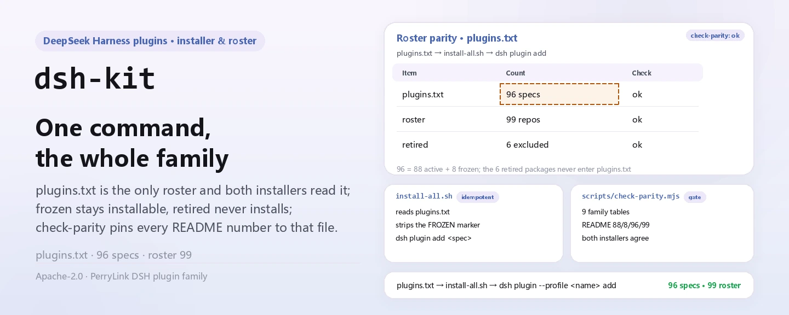
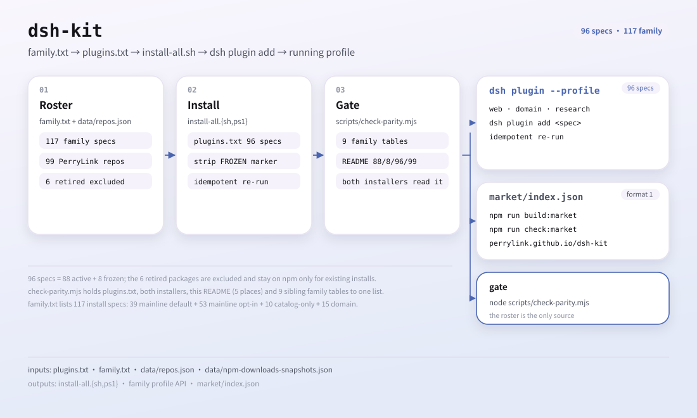
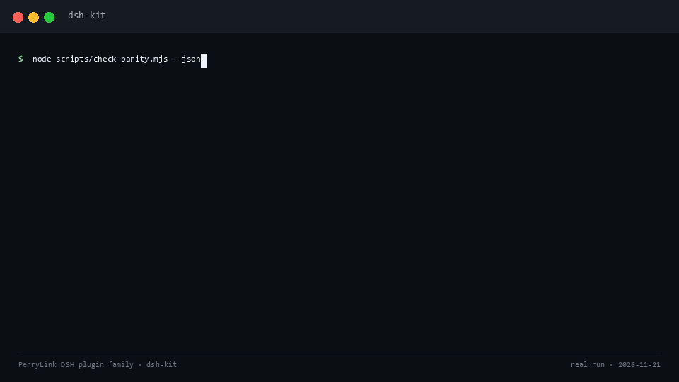

<picture>
  <source media="(prefers-color-scheme: dark)" srcset="docs/assets/dsh-kit-hero-en-dark.webp">
  
</picture>

# dsh-kit

PerryLink DeepSeek Harness प्लगइन परिवार का एक-कमांड इंस्टॉलर और मुख्य रोस्टर: plugins.txt ही एकमात्र सूची है, दोनों इंस्टॉलर उसे पढ़ते हैं, frozen इंस्टॉल होता है और retired नहीं।

[English](README.md) · [简体中文](README-zh.md) · [Español](README-es.md) · [Português](README-pt.md) · [हिन्दी](README-hi.md)

> यह फ़ाइल हिन्दी स्थानीयकृत प्रवेश है; पूरा तकनीकी विवरण अंग्रेज़ी [README.md](README.md) में है और यहाँ दोहराया नहीं गया है।

<picture>
  <source media="(prefers-color-scheme: dark)" srcset="docs/assets/dsh-kit-flow-v5-dark.svg">
  
</picture>

*संरचना: family.txt + data/repos.json → plugins.txt → install-all → dsh plugin add → गेट। चित्र के लेबल असली फ़ाइल नाम, स्क्रिप्ट नाम और कमांड हैं, इसलिए एक ही चित्र पाँचों भाषाओं के लिए है।*

## शुरुआत

*एनिमेशन: 2026-11-21 को node scripts/check-parity.mjs --json का दोबारा रन — वे गिनती जो गेट plugins.txt से निकालता है (असली stdout; मनुष्य के लिए सारांश पंक्तियाँ इस JSON से पहले छपती हैं)।*

कोई profile चुनें (जैसे `web`) और `./install-all.sh web` चलाएँ (Windows पर `.\install-all.ps1 -Profile web`) — पूरा परिवार इंस्टॉल; अलग-अलग पैकेज `dsh plugin --profile web add <spec>` से लगाएँ, जैसे `dsh-checkpoint-rewind`, `dsh-permission-rules`, `dsh-output-styles`। पूरे कमांड अंग्रेज़ी README के Quick start सेक्शन में हैं।

## अंदर क्या है (इंस्टॉलर 43 npm specs और 53 वैकल्पिक, कुल 96 कवर करते हैं)

चुने हुए प्लगइन चार समूहों में हैं: Claude Code समकक्ष तिकड़ी, memory/agents/workflow, डेवलपर और सुरक्षा उपकरण, तथा UX और माइग्रेशन (अंग्रेज़ी README के चार उपखंड); इनमें 2 retired और 1 frozen हैं, फिर भी इंस्टॉल योग्य रहते हैं। पूरी सूची `plugins.txt` है।

## नोट्स

`plugins.txt` ही एकमात्र सूची है: retired पैकेज नहीं आते, frozen पैकेजों पर `# 🧊 FROZEN` टिप्पणी होती है पर वे इंस्टॉल होते हैं; इंस्टॉलर idempotent हैं; `scripts/npm-downloads-snapshot.mjs` मासिक डाउनलोड दर्ज करता है; संस्करण npm के नवीनतम के साथ चलते हैं, reproducibility चाहिए तो प्रति-प्लगइन pin करें।

## व्यक्तिगत प्लगइन इंडेक्स

`market/index.json` इसी रोस्टर से बना DSH plugin-market format 1 इंडेक्स है, केवल PerryLink पैकेजों के साथ, `https://perrylink.github.io/dsh-kit/index.json` पर प्रकाशित; `npm run build:market` से फिर बनाएँ और `npm run check:market` से ऑफ़लाइन जाँचें।

## फ़ीडबैक

समस्याएँ और सुझाव संबंधित प्लगइन रिपॉज़िटरी में खोलें, या पूरे परिवार पर आधिकारिक DeepSeek Harness Discussions के “Show Your Plugins!” श्रेणी में चर्चा करें।

## PerryLink DSH प्लगइन परिवार

यह रिपॉज़िटरी [PerryLink](https://github.com/PerryLink) के DeepSeek Harness प्लगइन परिवार का हिस्सा है; तीन परतें और Phocinae लाइन [FAMILY.md](https://github.com/PerryLink/PerryLink/blob/main/FAMILY.md) में हैं और पूरा रोस्टर अंग्रेज़ी [README.md](README.md) में।

## इंस्टॉल रोस्टर से बाहर

दो सतहें केवल catalog-only हैं: `dsh-translate` 0.3.2 और 19-पैकेज research suite; वे नाम से इंस्टॉल होते हैं और `plugins.txt` / `family.txt` में नहीं हैं, इसलिए `install-all` उन्हें इंस्टॉल नहीं करता।

## संगतता कवरेज

`dsh-hcb` 0.12.0 में 143 पंक्तियाँ (136 checked + 7 tested) हैं, जो 112-पैकेज परिवार रोस्टर और 31 बाहरी प्लगइनों को कवर करती हैं; checker `dsh-standards@1.7.0` पर 143/143 पंक्तियाँ दर्ज करता है। पूरा विवरण अंग्रेज़ी README के Compatibility coverage सेक्शन में है।

[Privacy](PRIVACY.md) · [Security](SECURITY.md) · [Contributing](CONTRIBUTING.md) · [Changelog](CHANGELOG.md)
