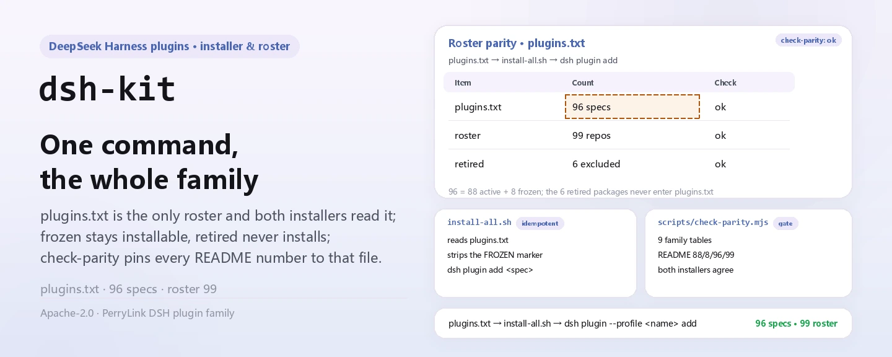
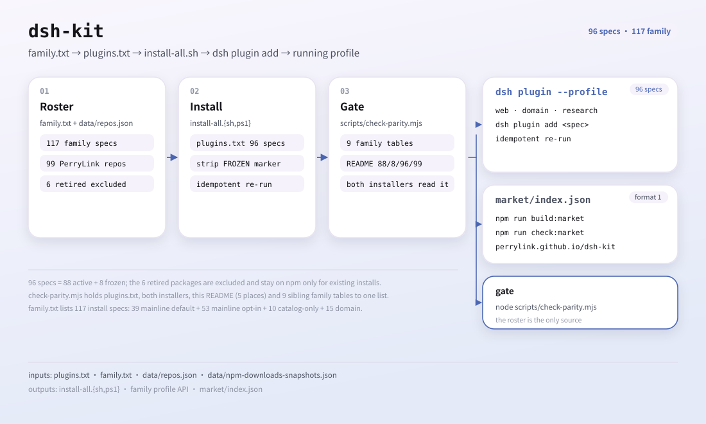
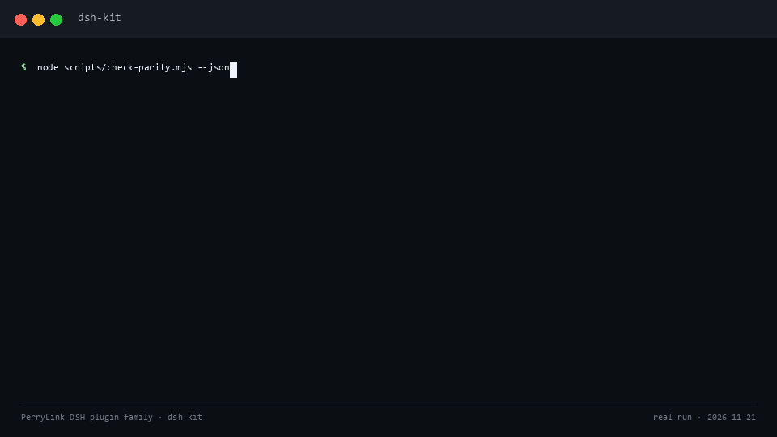

<div align="center">

<picture>
  <source media="(prefers-color-scheme: dark)" srcset="docs/assets/dsh-kit-hero-en-dark.webp">
  
</picture>

# dsh-kit

[English](README.md) · [简体中文](README-zh.md) · [Español](README-es.md) · [Português](README-pt.md) · [हिन्दी](README-hi.md)

</div>

[](https://gitee.com/perrylink/dsh-kit)
[](https://dshfind.com/plugins/PerryLink/dsh-kit?ref=badge)

[](https://github.com/PerryLink/dsh-kit/actions)
[](https://www.npmjs.com/package/dsh-kit)

**Pacote inicial de um único comando para os plugins PerryLink DeepSeek Harness mantidos ativamente, mais os congelados que continuam instaláveis.**

[dsh-kit](https://github.com/PerryLink/dsh-kit) é o instalador e o roster da linha principal da [família completa de plugins DSH da PerryLink](https://github.com/PerryLink/PerryLink/blob/main/FAMILY.md): padrões e verificações de três níveis, guias, a cadeia de ferramentas de desenvolvimento, plugins de runtime, a suíte de conformidade com 53 verificadores, operações de domínio, catálogos e a linha de decisão Phocinae, que é separada. Cada plugin sai com um manifesto `dsh.bundle` completo, documentação em cinco idiomas, CI e publicação no npm.

<picture>
  <source media="(prefers-color-scheme: dark)" srcset="docs/assets/dsh-kit-flow-v5-dark.svg">
  
</picture>

*Estrutura: family.txt + data/repos.json → plugins.txt → install-all → dsh plugin add → portão. Os rótulos do diagrama são nomes reais de arquivo, de script e de comando, então uma única imagem serve aos cinco idiomas.*


## Início rápido



*Animado: node scripts/check-parity.mjs --json reexecutado em 2026-11-21 — as contagens do roster que o portão deriva de plugins.txt (stdout real; as linhas de resumo humano são impressas antes deste JSON).*

Escolha um perfil (por exemplo `web`) e instale tudo:

```sh
# Linux / macOS
./install-all.sh web

# Windows PowerShell
.\install-all.ps1 -Profile web
```

Ou instale plugins individuais:

```sh
dsh plugin --profile web add dsh-checkpoint-rewind   # /rewind equivalent
dsh plugin --profile web add dsh-permission-rules    # allow/deny/ask rules
dsh plugin --profile web add dsh-output-styles       # outputStyles equivalent
```

## O que vem dentro (destaques selecionados — os instaladores cobrem 43 specs npm, mais 53 opcionais (96 no total))

Dois dos destaques abaixo estão **aposentados** e um está **congelado**. Todos continuam listados e continuam
instaláveis porque já há gente que os usa: 🧊 **FROZEN** significa que não há recursos novos e só uma quebra real é corrigida; 🚫 **RETIRED**
significa que o host já faz isso nativamente e o pacote está marcado como obsoleto no npm — os pacotes aposentados **não** estão em
`plugins.txt`, então uma instalação nova nunca os traz.

### O trio de paridade com o Claude Code

| Plugin | Resumo em uma linha |
|---|---|
| [dsh-checkpoint-rewind](https://github.com/PerryLink/dsh-checkpoint-rewind) | Snapshots com Git primeiro antes de cada mutação, bifurcações de sessão e restauração `/rewind` de um passo |
| [dsh-permission-rules](https://github.com/PerryLink/dsh-permission-rules) | Regras de permissão allow/deny/ask declarativas com auditoria, simulação (dry-run) e recarga a quente |
| [dsh-output-styles](https://github.com/PerryLink/dsh-output-styles) | Estilos de saída do modelo alternáveis em runtime com persistência por sessão |

### Memória, agentes e fluxo de trabalho

| Plugin | Resumo em uma linha | Estado |
|---|---|---|
| [dsh-memento](https://github.com/PerryLink/dsh-memento) | Memória entre sessões com aprovação: `ctx.memory` + SQLite + ferramenta `memory` | |
| [dsh-background-agents](https://github.com/PerryLink/dsh-background-agents) | Agentes filhos em segundo plano duráveis: progresso na barra lateral, mensageria, interrupção | 🚫 **RETIRED** — o host já traz subagentes continuáveis nativos |
| [dsh-doublecheck](https://github.com/PerryLink/dsh-doublecheck) | Guardião de disciplina de engenharia: arguição de requisitos, portões de teste e revisão adversária | |
| [dsh-auto-review](https://github.com/PerryLink/dsh-auto-review) | Auto-revisão com um segundo modelo na cadeia de aprovação, com falha fechada (fail-closed) | |

### Ferramentas de desenvolvimento e segurança

| Plugin | Resumo em uma linha |
|---|---|
| [dsh-mcp-panel](https://github.com/PerryLink/dsh-mcp-panel) | Painel de runtime MCP somente leitura: `/mcp` + aba Configurações |
| [dsh-lsp-actions](https://github.com/PerryLink/dsh-lsp-actions) | Diagnósticos LSP, formatação, autocompletar, ações de código e renomeação |
| [dsh-github-bot](https://github.com/PerryLink/dsh-github-bot) | Integração com PR e issues do GitHub; toda escrita passa por aprovação humana |
| [dsh-security-pack](https://github.com/PerryLink/dsh-security-pack) | Pacote de skills de auditoria de segurança: varredura de segredos, revisão de dependências e da cadeia de suprimentos |

### UX e migração

| Plugin | Resumo em uma linha | Estado |
|---|---|---|
| [dsh-session-pin](https://github.com/PerryLink/dsh-session-pin) | Fixa sessões na barra lateral da Web com ordenação durável | 🚫 **RETIRED** — o host já traz a fixação de sessões nativamente |
| [dsh-composer-history](https://github.com/PerryLink/dsh-composer-history) | Histórico de entrada estilo terminal para o compositor web: setas, Ctrl+R | |
| [dsh-primer](https://github.com/PerryLink/dsh-primer) | Base de conhecimento de desenvolvimento de plugins como skill de agente sob demanda | |
| [dsh-claude-move](https://github.com/PerryLink/dsh-claude-move) | Migra sessões, memória, skills e CLAUDE.md do Claude Code para o DSH | 🧊 FROZEN — veja o README do repositório |

## Notas

- O conjunto instalado é o [`plugins.txt`](plugins.txt) — um spec npm por linha e o único lugar onde o roster está escrito. Os dois instaladores o leem, e `node scripts/check-parity.mjs` prende a eles e a cada contagem desta página a esse arquivo.
- **Os pacotes aposentados não estão em `plugins.txt`**, então uma instalação nova nunca traz um deles, e o portão falha se alguém os adicionar de volta. Os cinco nomes aposentados, e o porquê, estão no comentário de cabeçalho do próprio arquivo.
- **Os pacotes congelados estão em `plugins.txt`** e são instalados; um comentário `# 🧊 FROZEN` no fim da linha os marca, e os dois instaladores removem esse comentário antes de chamar `dsh plugin add`.
- Os scripts de instalação são **idempotentes** — pode executá-los de novo sem risco.
- `dsh-security-pack` instala do npm.
- As versões acompanham os últimos lançamentos do npm; fixe uma versão específica por plugin se precisar de reprodutibilidade.
- Nomes obsoletos não são instalados: `dsh-background-agents`, `dsh-session-pin` e `dsh-team-rooms` (o host já implementa os três nativamente), mais `dsh-plugin-upgrade-015` e seu nome anterior `dsh-plugin-upgrade-rc1` (substituídos por `dsh-codemod`, que reúne todos os corredores em um só pacote). Eles continuam no npm para quem já os instalou.
- Licença: Apache-2.0 (a mesma da família de plugins).

## Índice pessoal de plugins

[`market/index.json`](market/index.json) é um índice no [formato 1 de plugin-market do DSH](https://github.com/deepseek-ai/deepseek-harness/blob/master/docs/user/guide/plugin-market.md) gerado a partir deste roster. Ele lista apenas pacotes da PerryLink e é publicado em `https://perrylink.github.io/dsh-kit/index.json`; adicione-o em **Plugins → Discover → Add index source** no DSH. É independente de qualquer mercado oficial ou da comunidade e não substitui os instaladores.

```sh
npm ci
npm run build:market   # regenerate from plugins.txt + family.txt (reads npm)
npm run check:market   # offline format/coverage checks
npm run test:market    # offline generator fixtures
```

Veja [`market/README.md`](market/README.md) para o suporte a clientes (incluindo os limites de dsh-Go/dsh-TUI), a denylist e a camada de exibição.

## Feedback

Issues e pedidos de recursos devem ser abertos no repositório do plugin correspondente, ou discuta a família inteira nas [Discussions oficiais do DeepSeek Harness](https://github.com/deepseek-ai/deepseek-harness/discussions) (categoria "Show Your Plugins!").


## Família de plugins PerryLink DSH

Este projeto faz parte da família de plugins do DeepSeek Harness da [PerryLink](https://github.com/PerryLink). A família tem três camadas — padrões e guias, cadeia de ferramentas de desenvolvimento, plugins de runtime e de domínio — mais a linha de decisão Phocinae; o índice completo grupo a grupo está em [FAMILY.md](https://github.com/PerryLink/PerryLink/blob/main/FAMILY.md). O roster de instalação fica recolhido aqui embaixo para que todo README mantenha uma primeira tela curta; expanda-o para ver cada linha e seu estado.

<details>
<summary>Expandir todos os plugins</summary>

| Plugin | Estado |
|---|---|
| **[dsh-aqua-input-check](https://github.com/PerryLink/dsh-aqua-input-check)** |  |
| **[dsh-archive-check](https://github.com/PerryLink/dsh-archive-check)** |  |
| **[dsh-auto-review](https://github.com/PerryLink/dsh-auto-review)** |  |
| **[dsh-bid-ca-precheck](https://github.com/PerryLink/dsh-bid-ca-precheck)** |  |
| **[dsh-bid-qual-check](https://github.com/PerryLink/dsh-bid-qual-check)** |  |
| **[dsh-check-pack](https://github.com/PerryLink/dsh-check-pack)** |  |
| **[dsh-checkpoint-rewind](https://github.com/PerryLink/dsh-checkpoint-rewind)** |  |
| **[dsh-click](https://github.com/PerryLink/dsh-click)** |  |
| **[dsh-clinic](https://github.com/PerryLink/dsh-clinic)** |  |
| **[dsh-codemod](https://github.com/PerryLink/dsh-codemod)** |  |
| **[dsh-composer-history](https://github.com/PerryLink/dsh-composer-history)** |  |
| **[dsh-contract-stance](https://github.com/PerryLink/dsh-contract-stance)** |  |
| **[dsh-customs-doc-check](https://github.com/PerryLink/dsh-customs-doc-check)** |  |
| **[dsh-data-quality](https://github.com/PerryLink/dsh-data-quality)** |  |
| **[dsh-demurrage-ledger](https://github.com/PerryLink/dsh-demurrage-ledger)** |  |
| **[dsh-dida](https://github.com/PerryLink/dsh-dida)** |  |
| **[dsh-doublecheck](https://github.com/PerryLink/dsh-doublecheck)** |  |
| **[dsh-drill-script-check](https://github.com/PerryLink/dsh-drill-script-check)** |  |
| **[dsh-eia-guide-check](https://github.com/PerryLink/dsh-eia-guide-check)** |  |
| **[dsh-emergency-plan](https://github.com/PerryLink/dsh-emergency-plan)** |  |
| **[dsh-essay-rubric-check](https://github.com/PerryLink/dsh-essay-rubric-check)** |  |
| **[dsh-evidence-check](https://github.com/PerryLink/dsh-evidence-check)** |  |
| **[dsh-export-ctl-check](https://github.com/PerryLink/dsh-export-ctl-check)** |  |
| **[dsh-fast](https://github.com/PerryLink/dsh-fast)** |  |
| **[dsh-fmea-table-check](https://github.com/PerryLink/dsh-fmea-table-check)** |  |
| **[dsh-forecast-penalty](https://github.com/PerryLink/dsh-forecast-penalty)** |  |
| **[dsh-fund-research](https://github.com/PerryLink/dsh-fund-research)** |  |
| **[dsh-github-bot](https://github.com/PerryLink/dsh-github-bot)** |  |
| **[dsh-gongwen-flow-check](https://github.com/PerryLink/dsh-gongwen-flow-check)** |  |
| **[dsh-gongwen-word-check](https://github.com/PerryLink/dsh-gongwen-word-check)** |  |
| **[dsh-guard-plan-qc](https://github.com/PerryLink/dsh-guard-plan-qc)** |  |
| **[dsh-hazchem-check](https://github.com/PerryLink/dsh-hazchem-check)** |  |
| **[dsh-hazplan-check](https://github.com/PerryLink/dsh-hazplan-check)** |  |
| **[dsh-hidden-risk-map](https://github.com/PerryLink/dsh-hidden-risk-map)** |  |
| **[dsh-hs-classify](https://github.com/PerryLink/dsh-hs-classify)** |  |
| **[dsh-icd-rule-check](https://github.com/PerryLink/dsh-icd-rule-check)** |  |
| **[dsh-industry-research](https://github.com/PerryLink/dsh-industry-research)** |  |
| **[dsh-lawcite-adapter](https://github.com/PerryLink/dsh-lawcite-adapter)** |  |
| **[dsh-laya](https://github.com/PerryLink/dsh-laya)** |  |
| **[dsh-lc-doc-check](https://github.com/PerryLink/dsh-lc-doc-check)** |  |
| **[dsh-learning-gap-check](https://github.com/PerryLink/dsh-learning-gap-check)** |  |
| **[dsh-library](https://github.com/PerryLink/dsh-library)** |  |
| **[dsh-local-ai](https://github.com/PerryLink/dsh-local-ai)** |  |
| **[dsh-lsp-actions](https://github.com/PerryLink/dsh-lsp-actions)** |  |
| **[dsh-mask](https://github.com/PerryLink/dsh-mask)** |  |
| **[dsh-mcp-panel](https://github.com/PerryLink/dsh-mcp-panel)** |  |
| **[dsh-medrec-qc](https://github.com/PerryLink/dsh-medrec-qc)** |  |
| **[dsh-memento](https://github.com/PerryLink/dsh-memento)** |  |
| **[dsh-nsfc-form-check](https://github.com/PerryLink/dsh-nsfc-form-check)** |  |
| **[dsh-nurse-record-check](https://github.com/PerryLink/dsh-nurse-record-check)** |  |
| **[dsh-observe](https://github.com/PerryLink/dsh-observe)** |  |
| **[dsh-origin-rvc-check](https://github.com/PerryLink/dsh-origin-rvc-check)** |  |
| **[dsh-ota-review-check](https://github.com/PerryLink/dsh-ota-review-check)** |  |
| **[dsh-output-styles](https://github.com/PerryLink/dsh-output-styles)** |  |
| **[dsh-paper-doc-adapter](https://github.com/PerryLink/dsh-paper-doc-adapter)** |  |
| **[dsh-param-repair](https://github.com/PerryLink/dsh-param-repair)** |  |
| **[dsh-permission-rules](https://github.com/PerryLink/dsh-permission-rules)** |  |
| **[dsh-permit-report-check](https://github.com/PerryLink/dsh-permit-report-check)** |  |
| **[dsh-phocinae](https://github.com/PerryLink/dsh-phocinae)** |  |
| **[dsh-phone-inbox](https://github.com/PerryLink/dsh-phone-inbox)** |  |
| **[dsh-pipeline-check](https://github.com/PerryLink/dsh-pipeline-check)** |  |
| **[dsh-pleading-draft](https://github.com/PerryLink/dsh-pleading-draft)** |  |
| **[dsh-policy-brief-draft](https://github.com/PerryLink/dsh-policy-brief-draft)** |  |
| **[dsh-power-loss-split](https://github.com/PerryLink/dsh-power-loss-split)** |  |
| **[dsh-power-ticket-check](https://github.com/PerryLink/dsh-power-ticket-check)** |  |
| **[dsh-ppap-check](https://github.com/PerryLink/dsh-ppap-check)** |  |
| **[dsh-primer](https://github.com/PerryLink/dsh-primer)** |  |
| **[dsh-protest-deadline](https://github.com/PerryLink/dsh-protest-deadline)** |  |
| **[dsh-railway-window](https://github.com/PerryLink/dsh-railway-window)** |  |
| **[dsh-repair-order-qc](https://github.com/PerryLink/dsh-repair-order-qc)** |  |
| **[dsh-research-report](https://github.com/PerryLink/dsh-research-report)** |  |
| **[dsh-review-reply-check](https://github.com/PerryLink/dsh-review-reply-check)** |  |
| **[dsh-rulefile-check](https://github.com/PerryLink/dsh-rulefile-check)** |  |
| **[dsh-safety-brief-check](https://github.com/PerryLink/dsh-safety-brief-check)** |  |
| **[dsh-scaffold](https://github.com/PerryLink/dsh-scaffold)** |  |
| **[dsh-score](https://github.com/PerryLink/dsh-score)** |  |
| **[dsh-security-pack](https://github.com/PerryLink/dsh-security-pack)** |  |
| **[dsh-session-sync](https://github.com/PerryLink/dsh-session-sync)** |  |
| **[dsh-site-log-check](https://github.com/PerryLink/dsh-site-log-check)** |  |
| **[dsh-soe-decision-check](https://github.com/PerryLink/dsh-soe-decision-check)** |  |
| **[dsh-soilwater-check](https://github.com/PerryLink/dsh-soilwater-check)** |  |
| **[dsh-sop-sync-check](https://github.com/PerryLink/dsh-sop-sync-check)** |  |
| **[dsh-spc-gbt-adapter](https://github.com/PerryLink/dsh-spc-gbt-adapter)** |  |
| **[dsh-talk](https://github.com/PerryLink/dsh-talk)** |  |
| **[dsh-tender-extract](https://github.com/PerryLink/dsh-tender-extract)** |  |
| **[dsh-tender-matrix](https://github.com/PerryLink/dsh-tender-matrix)** |  |
| **[dsh-test-drive](https://github.com/PerryLink/dsh-test-drive)** |  |
| **[dsh-warranty-calc](https://github.com/PerryLink/dsh-warranty-calc)** |  |
| **[dsh-autotier](https://github.com/PerryLink/dsh-autotier)** | 🧊 CONGELADO — ver o README do repositório |
| **[dsh-budget](https://github.com/PerryLink/dsh-budget)** | 🧊 CONGELADO — ver o README do repositório |
| **[dsh-cert-mcp](https://github.com/PerryLink/dsh-cert-mcp)** | 🧊 CONGELADO — ver o README do repositório |
| **[dsh-claude-move](https://github.com/PerryLink/dsh-claude-move)** | 🧊 CONGELADO — ver o README do repositório |
| **[dsh-community-bench](https://github.com/PerryLink/dsh-community-bench)** | 🧊 CONGELADO — ver o README do repositório |
| **[dsh-defend](https://github.com/PerryLink/dsh-defend)** | 🧊 CONGELADO — ver o README do repositório |
| **[dsh-draw](https://github.com/PerryLink/dsh-draw)** | 🧊 CONGELADO — ver o README do repositório |
| **[dsh-reach](https://github.com/PerryLink/dsh-reach)** | 🧊 CONGELADO — ver o README do repositório |
| **[dsh-background-agents](https://github.com/PerryLink/dsh-background-agents)** | 🚫 RETIRADO — ver o README do repositório |
| **[dsh-session-pin](https://github.com/PerryLink/dsh-session-pin)** | 🚫 RETIRADO — ver o README do repositório |
| **[dsh-team-rooms](https://github.com/PerryLink/dsh-team-rooms)** | 🚫 RETIRADO — ver o README do repositório |

</details>

## Fora do roster de instalação

Duas superfícies são apenas de catálogo, são instaladas pelo nome e ficam deliberadamente ausentes de `plugins.txt` / `family.txt`
(então o `install-all` não as instala):

- **`dsh-translate` 0.3.2** — tradução de página inteira na GUI web sobre a sua própria rota de modelo; código, caminhos, comandos,
  identificadores e nomes de produto permanecem como estão. `dsh plugin --profile <name> add dsh-translate`.
- **A suíte de pesquisa de 19 pacotes** — ferramentas de citação, afirmação, dataset, financiamento, manuscrito, meta-análise e
  reprodutibilidade; veja [FAMILY.md §10](https://github.com/PerryLink/PerryLink/blob/main/FAMILY.md#10-research-suite-catalog-only-19).


## Cobertura de compatibilidade

[HCB](https://github.com/PerryLink/dsh-hcb) 0.12.0 registra **143 linhas — 136 checked + 7 tested** — o roster completo de 112 pacotes da família (34 mainline-default + 53 opt-in + 10 catalog-only + 15 domain) mais 31 plugins externos — com **3 FLOW `manual`** e **portão 2 blocked · 31 review · 109 pilot · 1 `production-candidate`** (`dsh-plugin-guide@0.5.9` é o único PC; outras seis linhas estão tested: `dsh-budget@0.4.26`, `dsh-defend@0.3.28`, `dsh-mask@0.2.25`, `dsh-memento@0.5.31`, `dsh-observe@0.2.28`, `dsh-test-drive@0.3.26`; as outras 136 linhas não) e o checker marca **143/143 linhas em `dsh-standards@1.7.0`**. A CI pode chamar `PerryLink/dsh-hcb-action@main`.
