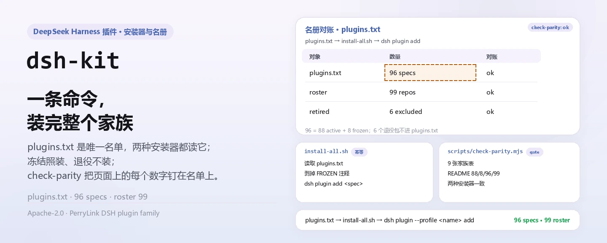
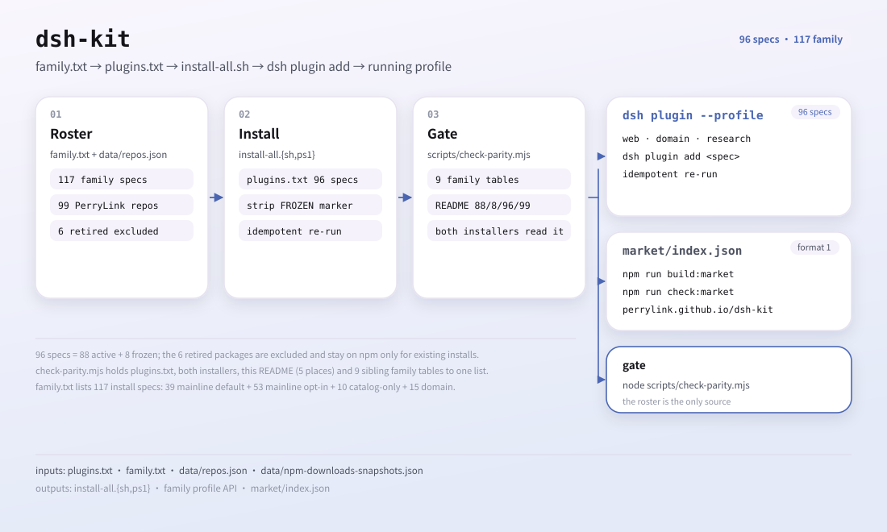
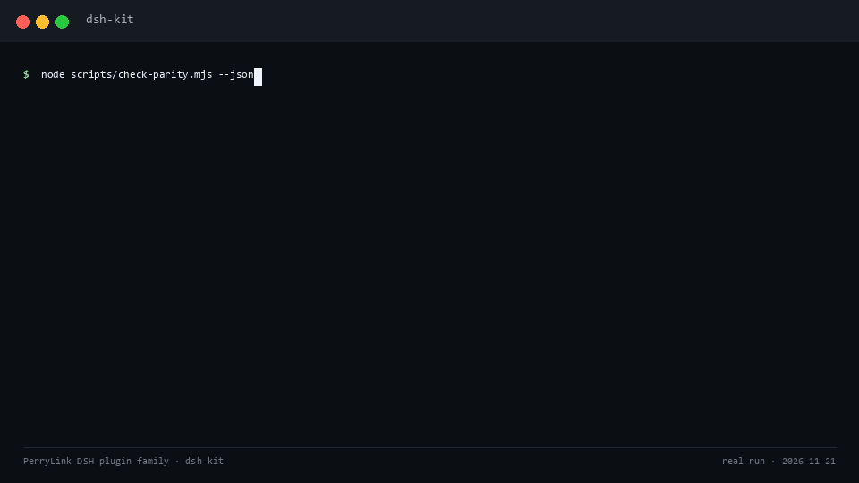

<picture>
  <source media="(prefers-color-scheme: dark)" srcset="docs/assets/dsh-kit-hero-zh-dark.webp">
  
</picture>

# dsh-kit

PerryLink DeepSeek Harness 插件家族的一条命令安装器与主名册：plugins.txt 是唯一名单，两种安装器都读它，冻结照装、退役不装。

[English](README.md) · [简体中文](README-zh.md) · [Español](README-es.md) · [Português](README-pt.md) · [हिन्दी](README-hi.md)

> 本文件是简体中文本地化入口；完整技术文档以英文 [README.md](README.md) 为准，正文不在此重复翻译。

<picture>
  <source media="(prefers-color-scheme: dark)" srcset="docs/assets/dsh-kit-flow-v5-dark.svg">
  
</picture>

*结构：family.txt + data/repos.json → plugins.txt → install-all → dsh plugin add → 门禁。图内是真实文件名、脚本名与命令，五语共用一张图。*

## 快速开始

*动图是本仓库门禁于 2026-11-21 的复跑：node scripts/check-parity.mjs --json，展示门禁从 plugins.txt 派生出的名册计数（真实 stdout；人读摘要行印在这段 JSON 之前）。*

选一个 profile（如 `web`）后跑 `./install-all.sh web`（Windows 用 `.\install-all.ps1 -Profile web`）即可整装；也可以用 `dsh plugin --profile web add <spec>` 单独装，例如 `dsh-checkpoint-rewind`、`dsh-permission-rules`、`dsh-output-styles`。完整命令与说明见英文 README 的 Quick start 一节。

## 内容精选（安装器覆盖 43 个 npm spec，另有 53 个可选，共 96 个）

精选按 Claude Code 对齐三件套、记忆／代理／工作流、开发者与安全工具、UX 与迁移四组列出（见英文 README 的四个三级小节）；其中 2 个已退役、1 个冻结，仍保留可安装。完整清单以 `plugins.txt` 为准。

## 说明

`plugins.txt` 是唯一名单，退役包不进名单、冻结包带 `# 🧊 FROZEN` 注释但仍安装；安装脚本幂等；`scripts/npm-downloads-snapshot.mjs` 按月记录下载量；版本跟随 npm 最新，需要可复现就逐插件锁版本。

## 个人插件索引

`market/index.json` 是由本名册生成的 DSH plugin-market format 1 索引，只列 PerryLink 包，发布在 `https://perrylink.github.io/dsh-kit/index.json`；用 `npm run build:market` 重建、`npm run check:market` 离线校验。

## 反馈

问题与需求提到对应插件仓，或到 DeepSeek Harness 官方 Discussions 的 “Show Your Plugins!” 分类讨论整个家族。

## PerryLink DSH 插件家族

本仓属于 [PerryLink](https://github.com/PerryLink) 的 DeepSeek Harness 插件家族；三层结构与 Phocinae 决策线见 [FAMILY.md](https://github.com/PerryLink/PerryLink/blob/main/FAMILY.md)，可展开名册在英文 [README.md](README.md) 中。

## 不在安装名册

两个面是 catalog-only：`dsh-translate` 0.3.2 与 19 包的研究套件，按名安装、不写进 `plugins.txt` / `family.txt`，所以 `install-all` 不会装它们。

## 兼容性覆盖

`dsh-hcb` 0.12.0 记录 143 行（136 checked + 7 tested），覆盖 112 包家族名册加 31 个外部插件；checker 在 `dsh-standards@1.7.0` 上 143/143 行。完整明细见英文 README 的 Compatibility coverage 一节。

[Privacy](PRIVACY.md) · [Security](SECURITY.md) · [Contributing](CONTRIBUTING.md) · [Changelog](CHANGELOG.md)
