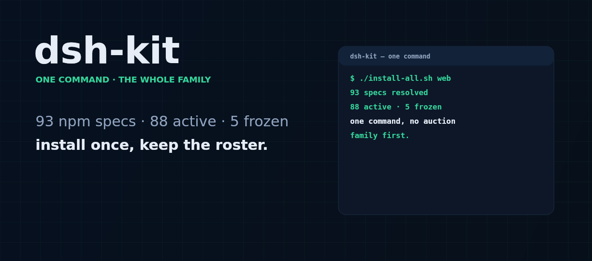
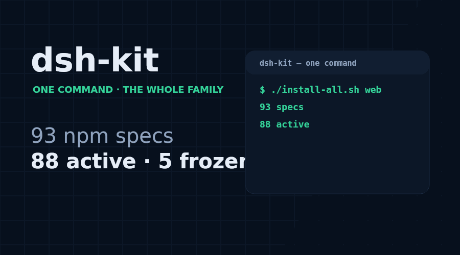

# dsh-kit
[](https://gitee.com/perrylink/dsh-kit)
[](https://dshfind.com/plugins/PerryLink/dsh-kit?ref=badge)

[](https://github.com/PerryLink/dsh-kit/actions)

**One-command starter pack: 87 actively maintained PerryLink DeepSeek Harness plugins, plus 5 frozen ones kept installable — 92 npm specs, one command.**

[dsh-kit](https://github.com/PerryLink/dsh-kit) is a curated collection of [PerryLink's DSH plugin family](https://github.com/PerryLink) — the Claude Code parity trio plus the rest of the family, across security, workflows, research, messaging bridges, and developer experience. Each plugin ships with a complete `dsh.bundle` manifest, five-language docs, CI, and npm publishing.





## Quick start

Pick a profile (e.g. `web`), then install everything:

```sh
# Linux / macOS
./install-all.sh web

# Windows PowerShell
.\install-all.ps1 -Profile web
```

Or install individual plugins:

```sh
dsh plugin --profile web add dsh-checkpoint-rewind   # /rewind equivalent
dsh plugin --profile web add dsh-permission-rules    # allow/deny/ask rules
dsh plugin --profile web add dsh-output-styles       # outputStyles equivalent
```

## What's inside (curated highlights — the installers cover 39 npm specs, plus 53 opt-in)

Two of the highlights below are **retired** and one is **frozen**. They all stay listed, and stay
installable, because people already run them: 🧊 **FROZEN** means no new features and only a real breakage gets fixed, 🚫 **RETIRED**
means the host now does this natively and the package is npm-deprecated — retired packages are **not** in
`plugins.txt`, so a fresh install never pulls them in.

### The Claude Code parity trio

| Plugin | One-liner |
|---|---|
| [dsh-checkpoint-rewind](https://github.com/PerryLink/dsh-checkpoint-rewind) | Git-first snapshots before every mutation, session forks, one-shot `/rewind` restore |
| [dsh-permission-rules](https://github.com/PerryLink/dsh-permission-rules) | Declarative allow/deny/ask permission rules with audit, dry-run and hot reload |
| [dsh-output-styles](https://github.com/PerryLink/dsh-output-styles) | Runtime-switchable model output styles with per-session persistence |

### Memory, agents & workflow

| Plugin | One-liner | Status |
|---|---|---|
| [dsh-memento](https://github.com/PerryLink/dsh-memento) | Approval-gated cross-session memory: `ctx.memory` + SQLite + `memory` tool | |
| [dsh-background-agents](https://github.com/PerryLink/dsh-background-agents) | Durable background child agents: sidebar progress, messaging, interrupt | 🚫 **RETIRED** — the host ships native continuable subagents |
| [dsh-doublecheck](https://github.com/PerryLink/dsh-doublecheck) | Engineering-discipline guard: requirements grill, test gates, adversary review | |
| [dsh-auto-review](https://github.com/PerryLink/dsh-auto-review) | Second-model auto-review on the approval chain, fail-closed | |

### Developer & safety tools

| Plugin | One-liner |
|---|---|
| [dsh-mcp-panel](https://github.com/PerryLink/dsh-mcp-panel) | Read-only MCP runtime panel: `/mcp` + Settings tab |
| [dsh-lsp-actions](https://github.com/PerryLink/dsh-lsp-actions) | LSP diagnostics, formatting, completion, code actions, rename |
| [dsh-github](https://github.com/PerryLink/dsh-github) | GitHub PR/issue integration; every write gated by human approval |
| [dsh-skill-pack-security](https://github.com/PerryLink/dsh-skill-pack-security) | Security-audit skill pack: secret scan, dependency and supply-chain review |

### UX & migration

| Plugin | One-liner | Status |
|---|---|---|
| [dsh-session-pin](https://github.com/PerryLink/dsh-session-pin) | Pin sessions in the Web sidebar with durable ordering | 🚫 **RETIRED** — the host ships session pinning natively |
| [dsh-composer-history](https://github.com/PerryLink/dsh-composer-history) | Terminal-style input history for the web composer: arrows, Ctrl+R | |
| [dsh-plugin-guide](https://github.com/PerryLink/dsh-plugin-guide) | Plugin-development knowledge base as an on-demand agent skill | |
| [dsh-claude-move](https://github.com/PerryLink/dsh-claude-move) | Migrate Claude Code sessions, memory, skills and CLAUDE.md into DSH | 🧊 FROZEN — see the repo README |

## Notes

- The installed set is [`plugins.txt`](plugins.txt) — one npm spec per line, and the only place the roster is written down. Both installers read it, and `node scripts/check-parity.mjs` holds them and every count on this page to it.
- **Retired packages are not in `plugins.txt`**, so a fresh install never pulls one in, and the gate fails if one is added back. The five retired names, and why, are listed in the file's own header comment.
- **Frozen packages are in `plugins.txt`** and are installed; a trailing `# 🧊 FROZEN` comment on their line marks them, and both installers strip that comment before calling `dsh plugin add`.
- Install scripts are **idempotent** — safe to re-run.
- `dsh-skill-pack-security` installs from its published provider package (`@perrylink/dsh-skill-pack-security-provider`); everything else installs from npm.
- Versions track the latest npm releases; pin a specific version per plugin if you need reproducibility.
- **Monthly download baseline:** `node scripts/npm-downloads-snapshot.mjs` reads this file's own roster and appends every spec's week and month npm downloads to `data/npm-downloads-snapshots.json`, so a distribution change can be measured against a previous month instead of asserted. It writes only that series — the profile page's download figure stays where it is. See [`scripts/README-npm-downloads-snapshot.md`](scripts/README-npm-downloads-snapshot.md).
- Deprecated names are not installed: `dsh-background-agents`, `dsh-session-pin` and `dsh-team-rooms` (the host implements all three natively now), and `dsh-plugin-upgrade-015` plus its earlier name `dsh-plugin-upgrade-rc1` (superseded by `dsh-plugin-upgrade`, which carries every corridor in one package). They stay on npm for anyone who already installed them.
- License: Apache-2.0 (matching the plugin family).

## Feedback

Issues and feature requests: open them on the individual plugin repo, or discuss the whole family on the [official DeepSeek Harness Discussions](https://github.com/deepseek-ai/deepseek-harness/discussions) (category "Show Your Plugins!").

## Family counts — one definition per number

The family states its size in five repositories, and the numbers only look contradictory
because each one counts a different set: 103 working copies, 99 of them non-private, 96 catalog
entries, 95 roster entries, 92 install specs, 45 family-table rows, 42 and 34 in the default
scope, 87 in the full one. Every row below is **derived, not typed**, and
`node scripts/check-parity.mjs` holds each one to `plugins.txt` (or to the file named in the last
column) and fails if a sixth definition appears anywhere in a sibling README's family blurb.

| Set | Count | Definition | Arithmetic | Sole home |
|---|---|---|---|---|
| Working copies | **103** | top-level directories carrying a `package.json`, both workspaces | 50 (`dsh/plugins`) + 53 (`dsh-plugins`) | measured; never quoted in prose |
| Non-private packages | **99** | those 103 minus the `"private": true` ones | 103 − `dsh-catalog`, `dsh-plugin-certification`, `dsh-skill-pack-security`, `jevcore` | measured; never quoted in prose |
| Install specs | **92** | one npm spec per non-comment line | 39 default + 53 `# opt-in` checkers | `plugins.txt` |
| Default install | **39** | what a plain `install-all.sh <profile>` installs | 92 − 53 | `plugins.txt`; gated in this page's headline |
| Active — full scope | **87** | install specs minus the frozen ones | 92 − 5 | this page's headline and its family blurb |
| Active — default scope | **34** | default install minus the frozen ones | 39 − 5 | every per-plugin README's family blurb |
| Roster — full scope | **95** | every roster member, retired included | 92 + 3 retired | this page's family blurb |
| Roster — default scope | **42** | default install plus the retired members | 39 + 3 | every per-plugin README's family blurb |
| Family-table rows | **45** | rows a family table actually lists; retired rows are kept, never deleted | 41 plugin repos + `dsh-plugin-kit` + `dsh-catalog` + `dsh-plugin-certification` + `dsh-plugin-upgrade-015` | every README's family table |
| Machine-readable roster | **95** entries | `dsh-plugin-kit/data/repos.json` | 94 with `role != "infra"` + the `dsh-plugin-kit` infra entry | `dsh-plugin-kit/data/repos.json` |
| Catalog entries | **96** | rows in the catalog's own table | 95 family repositories + the third-party `dsh-phocinae` | `dsh-catalog/data/packages.json` |

**Exactly two scopes, and no third, may appear in a family blurb**: the default scope
(34 active / 42 roster / 5 frozen / 3 retired — what the per-plugin READMEs state) and the full
scope (87 / 95 / 5 / 3 — what this page states). `check-parity.mjs` rejects any other
combination, which is how three READMEs still stating 33 active / 6 frozen were found on
2026-10-13 — five days after `dsh-memento` was unfrozen and their tables stopped matching their
own sentences.

Two consequences worth stating, because they are the two ways these numbers went wrong before:

- **A row is never deleted.** Retired and frozen rows stay in every family table with a status
  cell, so the count is the number of rows the table lists — not a tidier number that hides the
  retirement. `check-parity.mjs` also fails when a row the roster marks frozen or retired loses
  its status cell, and when a row the roster does *not* mark keeps one.
- **Judge status by the default branch.** Five family checkouts sit on a side branch, and
  `dsh-claude-move`'s local `kb-crosslink` and stale local `main` both still carry the
  pre-unfreeze table while `origin/main` is correct. The gate reads `origin/<default>` for those
  repositories rather than trusting the tree it was pointed at.

## PerryLink DSH Plugin Family

This project is one of the **87 actively maintained** DeepSeek Harness plugins from [PerryLink](https://github.com/PerryLink) — the roster is **95**, of which **5** are frozen and **3** retired; every one keeps its row below, with the reason in the Status column. If this one helps you, the others likely will too:

| Plugin | One-liner | Status |
|---|---|---|
| **[dsh-auto-review](https://github.com/PerryLink/dsh-auto-review)** | Second-model auto-review on the approval chain, fail-closed by default | |
| **[dsh-autotier](https://github.com/PerryLink/dsh-autotier)** | Automatic strong/cheap model-tier routing with deterministic risk guards and a `/tier` command | |
| **[dsh-background-agents](https://github.com/PerryLink/dsh-background-agents)** | Durable background child agents with a Web UI sidebar, messaging and interrupt | 🚫 **RETIRED** — see the note above |
| **[dsh-budget](https://github.com/PerryLink/dsh-budget)** | Cost governance for DeepSeek Harness: budgets, carbon, and latency in one panel. | 🧊 FROZEN — see the repo README |
| **[dsh-catalog](https://github.com/PerryLink/dsh-catalog)** | DSH Desktop Market standard catalog source for the PerryLink family | |
| **[dsh-cert-mcp](https://github.com/PerryLink/dsh-cert-mcp)** | Read-only MCP server exposing the certification registry: grades, snapshots and five-dimension evidence | |
| **[dsh-checkpoint-rewind](https://github.com/PerryLink/dsh-checkpoint-rewind)** | Unified session + workspace + config checkpoints with one-shot `/rewind` | |
| **[dsh-claude-move](https://github.com/PerryLink/dsh-claude-move)** | Migrate Claude Code, Codex, OpenCode and Hermes sessions, memories and skills into DSH | 🧊 FROZEN — see the repo README |
| **[dsh-click](https://github.com/PerryLink/dsh-click)** | Cross-platform native desktop control for DeepSeek Harness — Windows first. | |
| **[dsh-composer-history](https://github.com/PerryLink/dsh-composer-history)** | Terminal-style input history for the web composer: arrows, Ctrl+R search | |
| **[dsh-data-quality](https://github.com/PerryLink/dsh-data-quality)** | Deterministic dataset profiling, cleaning and citation verification | |
| **[dsh-defend](https://github.com/PerryLink/dsh-defend)** | Prompt-injection, jailbreak, and secret-leak defense for DeepSeek Harness. | 🧊 FROZEN — see the repo README |
| **[dsh-doublecheck](https://github.com/PerryLink/dsh-doublecheck)** | Engineering-discipline guard: requirements grill, test gates, adversary review | |
| **[dsh-draw](https://github.com/PerryLink/dsh-draw)** | Unified static-image generation routing for DeepSeek Harness. | 🧊 FROZEN — see the repo README |
| **[dsh-fast](https://github.com/PerryLink/dsh-fast)** | Read-only performance diagnostics: load, spill, compaction and cache hit rate | |
| **[dsh-fund-research](https://github.com/PerryLink/dsh-fund-research)** | Chinese mutual-fund research with sealed, traceable source snapshots | |
| **[dsh-github](https://github.com/PerryLink/dsh-github)** | GitHub PR/issue/CI integration with every write approval-gated | |
| **[dsh-industry-research](https://github.com/PerryLink/dsh-industry-research)** | Industry and company research pack: chain map, policy timeline, company cards | |
| **[dsh-laya](https://github.com/PerryLink/dsh-laya)** | Laya typed decisions (`noul`/`choice`/`score`) as a first-class Cordis service and model-visible tools | |
| **[dsh-library](https://github.com/PerryLink/dsh-library)** | Local document knowledge base with hybrid search and citation-aware injection | |
| **[dsh-local-ai](https://github.com/PerryLink/dsh-local-ai)** | Local Ollama model discovery and task-based routing with cloud fallback | |
| **[dsh-lsp-actions](https://github.com/PerryLink/dsh-lsp-actions)** | LSP diagnostics, formatting, completion, code actions, symbols and rename | |
| **[dsh-mask](https://github.com/PerryLink/dsh-mask)** | PII masking at the model boundary with a host-side restore table | |
| **[dsh-mcp-panel](https://github.com/PerryLink/dsh-mcp-panel)** | MCP management console: `/mcp` command, Settings tab and trial calls | |
| **[dsh-memento](https://github.com/PerryLink/dsh-memento)** | Approval-gated cross-session memory protocol (`ctx.memory` + SQLite) | |
| **[dsh-observe](https://github.com/PerryLink/dsh-observe)** | OpenTelemetry and Langfuse telemetry export from the session event stream | |
| **[dsh-output-styles](https://github.com/PerryLink/dsh-output-styles)** | Runtime-switchable model output styles | |
| **[dsh-permission-rules](https://github.com/PerryLink/dsh-permission-rules)** | Declarative allow/deny/ask rules plus a process-level network policy | |
| **[dsh-plugin-certification](https://github.com/PerryLink/dsh-plugin-certification)** | Community certification registry with repro-checkable grades and badges | |
| **[dsh-plugin-doctor](https://github.com/PerryLink/dsh-plugin-doctor)** | Zero-dependency static + sandbox smoke detector for DSH plugins | |
| **[dsh-plugin-guide](https://github.com/PerryLink/dsh-plugin-guide)** | Plugin-dev knowledge base, agent skill and the `dsh-plugin-dev` CLI toolchain | |
| **[dsh-plugin-kit](https://github.com/PerryLink/dsh-plugin-kit)** | Shared zero-runtime-dependency toolkit for the PerryLink DSH plugins | |
| **[dsh-plugin-portal](https://github.com/PerryLink/dsh-plugin-portal)** | Zero-dependency static portal rendering the whole plugin family as one page | |
| **[dsh-plugin-upgrade](https://github.com/PerryLink/dsh-plugin-upgrade)** | One-package, one-corridor-index plugin upgrade skill: routes a repository to the matching closed corridor card | |
| **[dsh-reach](https://github.com/PerryLink/dsh-reach)** | Multi-channel approval/question bridge: WeChat, Telegram, Feishu + a session console | 🧊 FROZEN — see the repo README |
| **[dsh-research-report](https://github.com/PerryLink/dsh-research-report)** | Verifiable research reports: evidence ledger, manifest seal, per-claim verdicts | |
| **[dsh-score](https://github.com/PerryLink/dsh-score)** | Multi-dimensional plugin quality scoring with an evidence-backed leaderboard | |
| **[dsh-session-pin](https://github.com/PerryLink/dsh-session-pin)** | Pin sessions in the Web sidebar with durable ordering | 🚫 **RETIRED** — see the note above |
| **[dsh-session-sync](https://github.com/PerryLink/dsh-session-sync)** | Git-backed cross-device session synchronization with keep-both merges | |
| **[dsh-skill-pack-security](https://github.com/PerryLink/dsh-skill-pack-security)** | Security-audit skill pack plus the `plugin_vet` supply-chain gate | |
| **[dsh-talk](https://github.com/PerryLink/dsh-talk)** | Voice-first session loop: speech-to-text input and text-to-speech replies | |
| **[dsh-team-rooms](https://github.com/PerryLink/dsh-team-rooms)** | Cross-session team rooms: shared message bus, task board and timeline | 🚫 **RETIRED** — see the note above |
| **[dsh-test-drive](https://github.com/PerryLink/dsh-test-drive)** | Isolated install-and-smoke test drives with a pass/fail matrix | |
| **[dsh-ticktick](https://github.com/PerryLink/dsh-ticktick)** | TickTick/Dida365 task bridge: session-header panel plus eleven agent tools | |
| **[dsh-translate](https://github.com/PerryLink/dsh-translate)** | Vendor parameter translation and deterministic JSON repair | |
