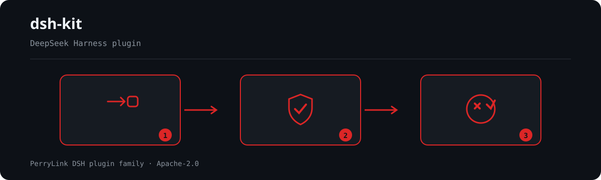

# dsh-kit
[](https://gitee.com/perrylink/dsh-kit)
[](https://dshfind.com/plugins/PerryLink/dsh-kit?ref=badge)

[](https://github.com/PerryLink/dsh-kit/actions)
[](https://www.npmjs.com/package/dsh-kit)

**One-command starter pack for the actively maintained PerryLink DeepSeek Harness plugins, plus frozen ones kept installable.**

[dsh-kit](https://github.com/PerryLink/dsh-kit) is the installer and mainline roster of [PerryLink's full DSH plugin family](https://github.com/PerryLink/PerryLink/blob/main/FAMILY.md) — three-level standards and checks, guides, the developer toolchain, runtime plugins, the 53-checker compliance suite, domain operations, catalogs, and the separate Phocinae decision line. Each plugin ships with a complete `dsh.bundle` manifest, five-language docs, CI, and npm publishing.



*Workflow overview: call → plugin → result. The kit is the maintenance surface.*


## Quick start

Pick a profile (e.g. `web`), then install everything:

```sh
# Linux / macOS
./install-all.sh web

# Windows PowerShell
.\install-all.ps1 -Profile web
```

Or install individual plugins:

```sh
dsh plugin --profile web add dsh-checkpoint-rewind   # /rewind equivalent
dsh plugin --profile web add dsh-permission-rules    # allow/deny/ask rules
dsh plugin --profile web add dsh-output-styles       # outputStyles equivalent
```

## What's inside (curated highlights — the installers cover 43 npm specs, plus 53 opt-in (96 total))

Two of the highlights below are **retired** and one is **frozen**. They all stay listed, and stay
installable, because people already run them: 🧊 **FROZEN** means no new features and only a real breakage gets fixed, 🚫 **RETIRED**
means the host now does this natively and the package is npm-deprecated — retired packages are **not** in
`plugins.txt`, so a fresh install never pulls them in.

### The Claude Code parity trio

| Plugin | One-liner |
|---|---|
| [dsh-checkpoint-rewind](https://github.com/PerryLink/dsh-checkpoint-rewind) | Git-first snapshots before every mutation, session forks, one-shot `/rewind` restore |
| [dsh-permission-rules](https://github.com/PerryLink/dsh-permission-rules) | Declarative allow/deny/ask permission rules with audit, dry-run and hot reload |
| [dsh-output-styles](https://github.com/PerryLink/dsh-output-styles) | Runtime-switchable model output styles with per-session persistence |

### Memory, agents & workflow

| Plugin | One-liner | Status |
|---|---|---|
| [dsh-memento](https://github.com/PerryLink/dsh-memento) | Approval-gated cross-session memory: `ctx.memory` + SQLite + `memory` tool | |
| [dsh-background-agents](https://github.com/PerryLink/dsh-background-agents) | Durable background child agents: sidebar progress, messaging, interrupt | 🚫 **RETIRED** — the host ships native continuable subagents |
| [dsh-doublecheck](https://github.com/PerryLink/dsh-doublecheck) | Engineering-discipline guard: requirements grill, test gates, adversary review | |
| [dsh-auto-review](https://github.com/PerryLink/dsh-auto-review) | Second-model auto-review on the approval chain, fail-closed | |

### Developer & safety tools

| Plugin | One-liner |
|---|---|
| [dsh-mcp-panel](https://github.com/PerryLink/dsh-mcp-panel) | Read-only MCP runtime panel: `/mcp` + Settings tab |
| [dsh-lsp-actions](https://github.com/PerryLink/dsh-lsp-actions) | LSP diagnostics, formatting, completion, code actions, rename |
| [dsh-github-bot](https://github.com/PerryLink/dsh-github-bot) | GitHub PR/issue integration; every write gated by human approval |
| [dsh-security-pack](https://github.com/PerryLink/dsh-security-pack) | Security-audit skill pack: secret scan, dependency and supply-chain review |

### UX & migration

| Plugin | One-liner | Status |
|---|---|---|
| [dsh-session-pin](https://github.com/PerryLink/dsh-session-pin) | Pin sessions in the Web sidebar with durable ordering | 🚫 **RETIRED** — the host ships session pinning natively |
| [dsh-composer-history](https://github.com/PerryLink/dsh-composer-history) | Terminal-style input history for the web composer: arrows, Ctrl+R | |
| [dsh-primer](https://github.com/PerryLink/dsh-primer) | Plugin-development knowledge base as an on-demand agent skill | |
| [dsh-claude-move](https://github.com/PerryLink/dsh-claude-move) | Migrate Claude Code sessions, memory, skills and CLAUDE.md into DSH | 🧊 FROZEN — see the repo README |

## Notes

- The installed set is [`plugins.txt`](plugins.txt) — one npm spec per line, and the only place the roster is written down. Both installers read it, and `node scripts/check-parity.mjs` holds them and every count on this page to it.
- **Retired packages are not in `plugins.txt`**, so a fresh install never pulls one in, and the gate fails if one is added back. The five retired names, and why, are listed in the file's own header comment.
- **Frozen packages are in `plugins.txt`** and are installed; a trailing `# 🧊 FROZEN` comment on their line marks them, and both installers strip that comment before calling `dsh plugin add`.
- Install scripts are **idempotent** — safe to re-run.
- `dsh-security-pack` installs from npm.
- Versions track the latest npm releases; pin a specific version per plugin if you need reproducibility.
- **Monthly download baseline:** `node scripts/npm-downloads-snapshot.mjs` reads this file's own roster and appends every spec's week and month npm downloads to `data/npm-downloads-snapshots.json`, so a distribution change can be measured against a previous month instead of asserted. It writes only that series — the profile page's download figure stays where it is. See [`scripts/README-npm-downloads-snapshot.md`](scripts/README-npm-downloads-snapshot.md).
- Deprecated names are not installed: `dsh-background-agents`, `dsh-session-pin` and `dsh-team-rooms` (the host implements all three natively now), and `dsh-plugin-upgrade-015` plus its earlier name `dsh-plugin-upgrade-rc1` (superseded by `dsh-codemod`, which carries every corridor in one package). They stay on npm for anyone who already installed them.
- License: Apache-2.0 (matching the plugin family).

## Feedback

Issues and feature requests: open them on the individual plugin repo, or discuss the whole family on the [official DeepSeek Harness Discussions](https://github.com/deepseek-ai/deepseek-harness/discussions) (category "Show Your Plugins!").


## PerryLink DSH Plugin Family

This project is part of the DeepSeek Harness plugin family from [PerryLink](https://github.com/PerryLink). The family has three layers — standards/guides, developer toolchain, runtime/domain plugins — plus the Phocinae decision line; the full group-by-group index is [FAMILY.md](https://github.com/PerryLink/PerryLink/blob/main/FAMILY.md). The install roster stays collapsed below so every README keeps a short first screen; expand it to see every row and its status.

<details>
<summary>Expand all plugins</summary>

| Plugin | Status |
|---|---|
| **[dsh-aqua-input-check](https://github.com/PerryLink/dsh-aqua-input-check)** |  |
| **[dsh-archive-check](https://github.com/PerryLink/dsh-archive-check)** |  |
| **[dsh-auto-review](https://github.com/PerryLink/dsh-auto-review)** |  |
| **[dsh-autotier](https://github.com/PerryLink/dsh-autotier)** | 🧊 FROZEN — see the repo README |
| **[dsh-bid-ca-precheck](https://github.com/PerryLink/dsh-bid-ca-precheck)** |  |
| **[dsh-bid-qual-check](https://github.com/PerryLink/dsh-bid-qual-check)** |  |
| **[dsh-cert-mcp](https://github.com/PerryLink/dsh-cert-mcp)** | 🧊 FROZEN — see the repo README |
| **[dsh-checkpoint-rewind](https://github.com/PerryLink/dsh-checkpoint-rewind)** |  |
| **[dsh-click](https://github.com/PerryLink/dsh-click)** |  |
| **[dsh-community-bench](https://github.com/PerryLink/dsh-community-bench)** | 🧊 FROZEN — see the repo README |
| **[dsh-composer-history](https://github.com/PerryLink/dsh-composer-history)** |  |
| **[dsh-contract-stance](https://github.com/PerryLink/dsh-contract-stance)** |  |
| **[dsh-customs-doc-check](https://github.com/PerryLink/dsh-customs-doc-check)** |  |
| **[dsh-data-quality](https://github.com/PerryLink/dsh-data-quality)** |  |
| **[dsh-demurrage-ledger](https://github.com/PerryLink/dsh-demurrage-ledger)** |  |
| **[dsh-doublecheck](https://github.com/PerryLink/dsh-doublecheck)** |  |
| **[dsh-drill-script-check](https://github.com/PerryLink/dsh-drill-script-check)** |  |
| **[dsh-eia-guide-check](https://github.com/PerryLink/dsh-eia-guide-check)** |  |
| **[dsh-emergency-plan](https://github.com/PerryLink/dsh-emergency-plan)** |  |
| **[dsh-essay-rubric-check](https://github.com/PerryLink/dsh-essay-rubric-check)** |  |
| **[dsh-evidence-check](https://github.com/PerryLink/dsh-evidence-check)** |  |
| **[dsh-export-ctl-check](https://github.com/PerryLink/dsh-export-ctl-check)** |  |
| **[dsh-fast](https://github.com/PerryLink/dsh-fast)** |  |
| **[dsh-fmea-table-check](https://github.com/PerryLink/dsh-fmea-table-check)** |  |
| **[dsh-forecast-penalty](https://github.com/PerryLink/dsh-forecast-penalty)** |  |
| **[dsh-fund-research](https://github.com/PerryLink/dsh-fund-research)** |  |
| **[dsh-github-bot](https://github.com/PerryLink/dsh-github-bot)** |  |
| **[dsh-gongwen-flow-check](https://github.com/PerryLink/dsh-gongwen-flow-check)** |  |
| **[dsh-gongwen-word-check](https://github.com/PerryLink/dsh-gongwen-word-check)** |  |
| **[dsh-guard-plan-qc](https://github.com/PerryLink/dsh-guard-plan-qc)** |  |
| **[dsh-hazchem-check](https://github.com/PerryLink/dsh-hazchem-check)** |  |
| **[dsh-hazplan-check](https://github.com/PerryLink/dsh-hazplan-check)** |  |
| **[dsh-hidden-risk-map](https://github.com/PerryLink/dsh-hidden-risk-map)** |  |
| **[dsh-hs-classify](https://github.com/PerryLink/dsh-hs-classify)** |  |
| **[dsh-icd-rule-check](https://github.com/PerryLink/dsh-icd-rule-check)** |  |
| **[dsh-industry-research](https://github.com/PerryLink/dsh-industry-research)** |  |
| **[dsh-lawcite-adapter](https://github.com/PerryLink/dsh-lawcite-adapter)** |  |
| **[dsh-laya](https://github.com/PerryLink/dsh-laya)** |  |
| **[dsh-lc-doc-check](https://github.com/PerryLink/dsh-lc-doc-check)** |  |
| **[dsh-learning-gap-check](https://github.com/PerryLink/dsh-learning-gap-check)** |  |
| **[dsh-library](https://github.com/PerryLink/dsh-library)** |  |
| **[dsh-local-ai](https://github.com/PerryLink/dsh-local-ai)** |  |
| **[dsh-lsp-actions](https://github.com/PerryLink/dsh-lsp-actions)** |  |
| **[dsh-mask](https://github.com/PerryLink/dsh-mask)** |  |
| **[dsh-mcp-panel](https://github.com/PerryLink/dsh-mcp-panel)** |  |
| **[dsh-medrec-qc](https://github.com/PerryLink/dsh-medrec-qc)** |  |
| **[dsh-memento](https://github.com/PerryLink/dsh-memento)** |  |
| **[dsh-nsfc-form-check](https://github.com/PerryLink/dsh-nsfc-form-check)** |  |
| **[dsh-nurse-record-check](https://github.com/PerryLink/dsh-nurse-record-check)** |  |
| **[dsh-observe](https://github.com/PerryLink/dsh-observe)** |  |
| **[dsh-origin-rvc-check](https://github.com/PerryLink/dsh-origin-rvc-check)** |  |
| **[dsh-ota-review-check](https://github.com/PerryLink/dsh-ota-review-check)** |  |
| **[dsh-output-styles](https://github.com/PerryLink/dsh-output-styles)** |  |
| **[dsh-paper-doc-adapter](https://github.com/PerryLink/dsh-paper-doc-adapter)** |  |
| **[dsh-permission-rules](https://github.com/PerryLink/dsh-permission-rules)** |  |
| **[dsh-permit-report-check](https://github.com/PerryLink/dsh-permit-report-check)** |  |
| **[dsh-pipeline-check](https://github.com/PerryLink/dsh-pipeline-check)** |  |
| **[dsh-pleading-draft](https://github.com/PerryLink/dsh-pleading-draft)** |  |
| **[dsh-clinic](https://github.com/PerryLink/dsh-clinic)** |  |
| **[dsh-primer](https://github.com/PerryLink/dsh-primer)** |  |
| **[dsh-scaffold](https://github.com/PerryLink/dsh-scaffold)** |  |
| **[dsh-codemod](https://github.com/PerryLink/dsh-codemod)** |  |
| **[dsh-policy-brief-draft](https://github.com/PerryLink/dsh-policy-brief-draft)** |  |
| **[dsh-power-loss-split](https://github.com/PerryLink/dsh-power-loss-split)** |  |
| **[dsh-power-ticket-check](https://github.com/PerryLink/dsh-power-ticket-check)** |  |
| **[dsh-ppap-check](https://github.com/PerryLink/dsh-ppap-check)** |  |
| **[dsh-protest-deadline](https://github.com/PerryLink/dsh-protest-deadline)** |  |
| **[dsh-railway-window](https://github.com/PerryLink/dsh-railway-window)** |  |
| **[dsh-repair-order-qc](https://github.com/PerryLink/dsh-repair-order-qc)** |  |
| **[dsh-research-report](https://github.com/PerryLink/dsh-research-report)** |  |
| **[dsh-review-reply-check](https://github.com/PerryLink/dsh-review-reply-check)** |  |
| **[dsh-rulefile-check](https://github.com/PerryLink/dsh-rulefile-check)** |  |
| **[dsh-safety-brief-check](https://github.com/PerryLink/dsh-safety-brief-check)** |  |
| **[dsh-score](https://github.com/PerryLink/dsh-score)** |  |
| **[dsh-session-sync](https://github.com/PerryLink/dsh-session-sync)** |  |
| **[dsh-site-log-check](https://github.com/PerryLink/dsh-site-log-check)** |  |
| **[dsh-security-pack](https://github.com/PerryLink/dsh-security-pack)** |  |
| **[dsh-soe-decision-check](https://github.com/PerryLink/dsh-soe-decision-check)** |  |
| **[dsh-soilwater-check](https://github.com/PerryLink/dsh-soilwater-check)** |  |
| **[dsh-sop-sync-check](https://github.com/PerryLink/dsh-sop-sync-check)** |  |
| **[dsh-spc-gbt-adapter](https://github.com/PerryLink/dsh-spc-gbt-adapter)** |  |
| **[dsh-talk](https://github.com/PerryLink/dsh-talk)** |  |
| **[dsh-tender-extract](https://github.com/PerryLink/dsh-tender-extract)** |  |
| **[dsh-tender-matrix](https://github.com/PerryLink/dsh-tender-matrix)** |  |
| **[dsh-test-drive](https://github.com/PerryLink/dsh-test-drive)** |  |
| **[dsh-dida](https://github.com/PerryLink/dsh-dida)** |  |
| **[dsh-param-repair](https://github.com/PerryLink/dsh-param-repair)** |  |
| **[dsh-warranty-calc](https://github.com/PerryLink/dsh-warranty-calc)** |  |
| **[dsh-catalog](https://github.com/PerryLink/dsh-catalog)** |  |
| **[dsh-plugin-certification](https://github.com/PerryLink/dsh-plugin-certification)** |  |
| **[dsh-plugin-portal](https://github.com/PerryLink/dsh-plugin-portal)** |  |
| **[dsh-budget](https://github.com/PerryLink/dsh-budget)** | 🧊 FROZEN — see the repo README |
| **[dsh-claude-move](https://github.com/PerryLink/dsh-claude-move)** | 🧊 FROZEN — see the repo README |
| **[dsh-defend](https://github.com/PerryLink/dsh-defend)** | 🧊 FROZEN — see the repo README |
| **[dsh-draw](https://github.com/PerryLink/dsh-draw)** | 🧊 FROZEN — see the repo README |
| **[dsh-reach](https://github.com/PerryLink/dsh-reach)** | 🧊 FROZEN — see the repo README |
| **[dsh-background-agents](https://github.com/PerryLink/dsh-background-agents)** | 🚫 RETIRED — see the repo README |
| **[dsh-session-pin](https://github.com/PerryLink/dsh-session-pin)** | 🚫 RETIRED — see the repo README |
| **[dsh-team-rooms](https://github.com/PerryLink/dsh-team-rooms)** | 🚫 RETIRED — see the repo README |

</details>
